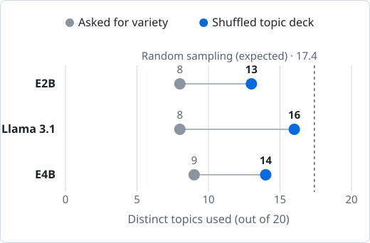
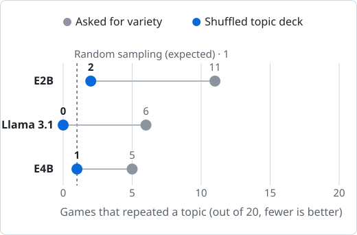
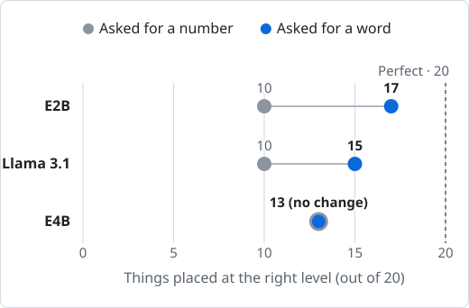
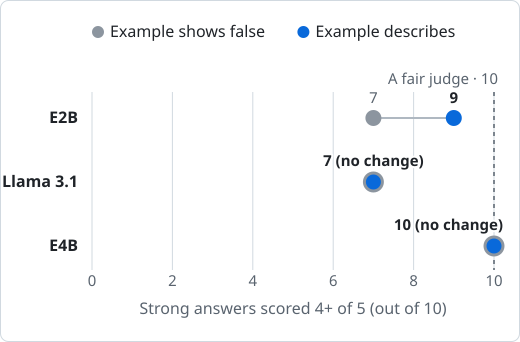

# llm-on-a-leash

**Constraint-first patterns for LLM games, on small models.**

Companion code for two dev blog posts from building [NextOath](https://nextoath.ai): [*Keeping the LLM on a Leash*](https://nextoath.ai/blog/llm-on-a-leash) and [*Small Tricks for Small Models*](https://nextoath.ai/blog/small-model-tricks) (both published 2026-11-18).

## Quick start

```bash
npm install
npm run report            # every table, from the saved replies; no model needed
```

To run one experiment on your own machine, install [Ollama](https://ollama.com) and:

```bash
npx tsx measure/faithful.ts                           # gemma4:e4b, downloaded if missing
OLLAMA_MODEL=llama3.1:8b npx tsx measure/faithful.ts  # you may set your model name
npm run report                                        # your model appears next to mine
```

To run all tests:

```bash
npm run measure
```

## Results

Models, least capable first: **Gemma 4 E2B**, **Llama 3.1 8B** and **Gemma 4 E4B**

Each result below is **before → after** on the same test: the gray dot is before, the blue dot is after. The dashed line on each chart is the target: what a perfect prompt, or picking at random, would give. The *p* under each chart is the chance of a gap at least that big if the change did nothing, comparing the same games or items both ways. Small is convincing; above about 0.1 it could easily be luck.

### Dealing topics from a shuffled deck beats asking for variety, on every model.

How many of the 20 topics got used across 40 questions. Picking at random you'd expect about **17.4**.

<picture>
  <source media="(prefers-color-scheme: dark)" srcset="assets/charts/deck-topics-dark.svg">
  
</picture>

*p*: E2B 0.005, Llama 3.1 0.011, E4B 0.010. Small on all three models.

How many of 20 games asked about the same topic twice in a row. Picking at random you'd expect about **1**.

<picture>
  <source media="(prefers-color-scheme: dark)" srcset="assets/charts/deck-repeats-dark.svg">
  
</picture>

*p*: E2B 0.011, Llama 3.1 0.016, E4B 0.109. E4B repeated least to begin with, so its gap is the least certain: at 0.109 it could be luck.

### Asking for a word instead of a number puts more things at the right level, on the smaller models.

Twenty things with an obvious level (five each of rare, uncommon, common, everywhere). A perfect answer places all **20**. Before, the model gave a number from 0 to 1; after, one of the four words.

<picture>
  <source media="(prefers-color-scheme: dark)" srcset="assets/charts/words-numbers-dark.svg">
  
</picture>

*p*: E2B 0.008, Llama 3.1 0.090, E4B 0.688. Asked for a number, E2B never once landed in the middle two levels. E4B held up either way, so for it this is insurance, not a fix.

### Describing the answer in the format example instead of showing one helps one model and not the others.

How many of 10 strong answers the judge scored 4 of 5 or better. A fair judge would score all **10**. Before, the format example showed `false` in every slot; after, it described each slot.

<picture>
  <source media="(prefers-color-scheme: dark)" srcset="assets/charts/describe-example-dark.svg">
  
</picture>

Same answers judged both ways, counting criteria passed of 5: E2B 2 rose, 0 fell, net +4 (*p* 0.25); Llama 3.1 1 rose, 1 fell, net 0 (*p* 0.75); E4B none moved. E2B's gain is consistent in direction, but 10 answers are too few to rule out luck. It didn't make the judge easier to please either: no weak answer reached 4 on any model. Test it on yours.

Two more are measured and weaker: a forgiving parser rescued 40 of 260 answers on E4B and none on the other two (entry 4), and handing the judge an earlier call's guess pulled it toward the guess on both Gemmas but not firmly at 30 plans (entry 5). One is measured and did not hold: yes/no questions in place of a "pick one" field fixed one model and broke another (entry 8). The field guide has the full set, with evidence labels and numbers where measured, and the report prints every table.

## What's here

| Path | What it is |
|---|---|
| [`PATTERNS.md`](PATTERNS.md) | **Start here.** The field guide: symptom, fix, how to check, and how much evidence is behind each entry. |
| [`measure/`](measure/) | The tests, the saved replies, and `npm run report`. |
| [`demos/`](demos/) | Three runnable demos that replay recorded replies (`npm run demo:deck`, `demo:judge`, `demo:fences`; add `--live` to use your model). |
| [`.claude/skills/small-model-prompt-review/`](.claude/skills/small-model-prompt-review/SKILL.md) | A Claude Code skill that reviews a prompt and its parser against the guide. Copy it into your repo. |
| [`.claude/skills/pin-the-fix/`](.claude/skills/pin-the-fix/SKILL.md) | A Claude Code skill that writes an ast-grep fence for a one-line fix, plus the test proving the fence fires. |

## How much to trust it

Each entry in the guide is labelled **reproduced here** (`npm run report` prints it, `npm run measure` re-runs it), **measured in NextOath, not reproduced here** (real numbers from the game's own harness that this repo doesn't regenerate), or **experience** (unmeasured).

These are small-model results, from 20 to 40 items per test. That's enough to see a clear gap and too few to trust a one- or two-point difference. Several patterns help one model and do nothing for another. The tests use the game's real prompt text but a short generic world, so they run lighter than the game does (about 750 prompt tokens for the judge here against about 1,300 in the game). Run them on yours, with your full prompt, before you trust them. If you have an alternative pattern, see [CONTRIBUTING.md](CONTRIBUTING.md); I'll consider revising or adding it.

## License

MIT. See [LICENSE](LICENSE).
